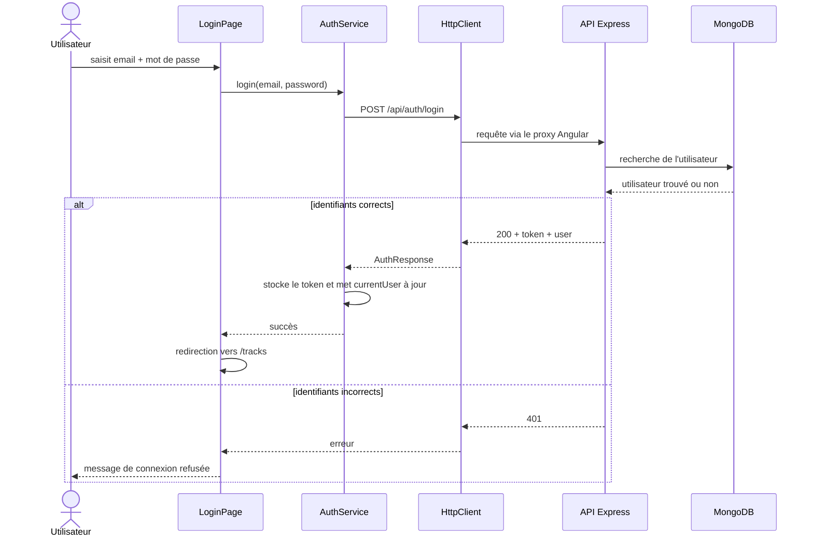

# Compte rendu — TP1, TP2 et TP3 Angular

Ce rapport regroupe le travail réalisé sur les trois séances autour de l'application **Guitar Practice Cloud**. Le projet a été réalisé **individuellement**.

L'objectif général était de compléter le frontend Angular fourni tout en conservant le backend Express/Mongoose pour les missions obligatoires. J'ai suivi l'ordre des sujets : missions 0, 1, 2, 3, 5, 6 et 7. Il n'y a pas de mission 4 dans les sujets fournis.

Les captures et sorties de commandes sont regroupées dans [docs/preuves/README.md](docs/preuves/README.md).

---

## Mise en route du projet

Le backend utilise Express, Mongoose et MongoDB Atlas. Le frontend utilise Angular et communique avec l'API par l'intermédiaire de `HttpClient`.

Le proxy du frontend est configuré dans [frontend-starter/proxy.conf.json](frontend-starter/proxy.conf.json) pour transmettre `/api` vers `http://localhost:3000`.

Pour lancer le projet :

```bash
# terminal 1
cd backend
npm start

# terminal 2
cd frontend-starter
npm start
```

Le endpoint `GET /api/health` permet de vérifier rapidement que le serveur répond. Les traces du backend apparaissent dans son terminal et les requêtes frontend peuvent être observées dans l'onglet **Network** du navigateur.

Les captures utilisées pour le rapport ne contiennent pas de mot de passe, de JWT ni d'URI MongoDB.

---

# TP1 — Authentification et profil

## Mission 0 — Cartographier l'application

Avant de modifier le code, j'ai commencé par repérer les fichiers importants afin de comprendre la séparation des responsabilités.

| Élément | Fichier principal | Rôle |
|---|---|---|
| Démarrage Angular | [frontend-starter/src/main.ts](frontend-starter/src/main.ts) | démarre l'application et configure Router, HttpClient et l'intercepteur |
| Routes | [frontend-starter/src/app/routes.ts](frontend-starter/src/app/routes.ts) | définit `/login`, `/register`, `/profile` et `/tracks` |
| Composant racine | [app.ts](frontend-starter/src/app/components/app/app.ts) | navigation générale et déconnexion |
| Authentification | [auth.service.ts](frontend-starter/src/app/shared/services/auth.service.ts) | connexion, inscription, profil, token et utilisateur courant |
| Intercepteur | [auth.interceptor.ts](frontend-starter/src/app/shared/interceptors/auth.interceptor.ts) | ajoute le JWT aux requêtes protégées et traite les `401` |
| Guard | [auth.guard.ts](frontend-starter/src/app/shared/guards/auth.guard.ts) | empêche l'accès local à certaines routes sans token |
| Bibliothèque | [tracks-page.ts](frontend-starter/src/app/components/tracks-page/tracks-page.ts) | affichage, upload, lecture et suppression des pistes |
| Service des pistes | [track.service.ts](frontend-starter/src/app/shared/services/track.service.ts) | appels HTTP liés aux pistes |
| Backend | [backend/src/app.js](backend/src/app.js) | routes Express, authentification, validations et accès aux données |
| Utilisateur MongoDB | [backend/src/models/User.js](backend/src/models/User.js) | schéma utilisateur et gestion du mot de passe |

### Trajet d'une connexion



Le point important est qu'Angular ne communique jamais directement avec MongoDB. Le composant appelle un service, le service utilise `HttpClient`, puis Express traite la requête et accède à MongoDB avec Mongoose.

### Routes principales utilisées

| Méthode | URL | Accès |
|---|---|---|
| GET | `/api/health` | public |
| POST | `/api/auth/register` | public |
| POST | `/api/auth/login` | public |
| GET | `/api/users/me` | JWT |
| PUT | `/api/users/me` | JWT |
| GET | `/api/tracks?page=1&limit=5` | JWT |
| POST | `/api/tracks` | JWT |
| GET | `/api/tracks/:id/audio` | JWT + propriétaire |
| DELETE | `/api/tracks/:id` | JWT + propriétaire |

Le guard Angular ne suffit pas pour sécuriser une ressource. La protection réelle est faite par le backend, qui vérifie le JWT et, pour les pistes, leur propriétaire.

---

## Mission 1 — Inscription, connexion et profil

Les pages de connexion, inscription et profil utilisent des **Reactive Forms**. Les validations sont faites côté frontend pour donner un retour rapide à l'utilisateur, mais le backend conserve ses propres validations.

Les composants n'appellent pas directement `HttpClient`. Ils passent par `AuthService`, ce qui permet de garder une séparation claire entre l'interface et les échanges HTTP.

### Connexion et stockage du JWT

Après une connexion ou une inscription réussie, `AuthService` :

1. reçoit le JWT et l'utilisateur public ;
2. sauvegarde le JWT dans `localStorage` ;
3. met à jour les Signals `token` et `currentUser` ;
4. laisse ensuite le composant rediriger l'utilisateur.

À la déconnexion, le token est supprimé du stockage local et les Signals sont remis à `null`.

### Signal et localStorage

Les deux mécanismes ne servent pas à la même chose :

- un **Signal** contient un état réactif en mémoire. Lorsque sa valeur change, Angular peut mettre à jour l'interface ;
- `localStorage` conserve une chaîne de caractères après un rechargement de page. Dans ce projet, il sert surtout à garder le JWT.

Un changement dans `localStorage` ne met donc pas automatiquement `currentUser` à jour, et un changement de Signal n'est pas automatiquement persistant.

### Mise à jour du profil

La modification du nom passe par plusieurs fichiers :

1. [profile-page.html](frontend-starter/src/app/components/profile-page/profile-page.html) affiche le formulaire ;
2. [profile-page.ts](frontend-starter/src/app/components/profile-page/profile-page.ts) valide et déclenche l'enregistrement ;
3. [auth.service.ts](frontend-starter/src/app/shared/services/auth.service.ts) envoie `PUT /api/users/me` ;
4. [auth.interceptor.ts](frontend-starter/src/app/shared/interceptors/auth.interceptor.ts) ajoute le JWT ;
5. [backend/src/app.js](backend/src/app.js) vérifie le token puis met à jour l'utilisateur ;
6. MongoDB enregistre la nouvelle valeur.

Le service remplace ensuite `currentUser` par la réponse du serveur afin que l'application affiche immédiatement le nouveau nom.

### Gestion du 401

J'ai distingué deux cas :

- un `401` pendant la connexion signifie généralement que les identifiants sont incorrects ;
- un `401` sur une route protégée signifie que le token n'est plus accepté. Dans ce cas, l'intercepteur nettoie l'état local et renvoie vers `/login`.

La simple présence d'un token dans le navigateur ne permet pas de savoir s'il est encore valide. C'est le serveur qui fait cette vérification.

### Vérifications TP1

Le parcours final a permis de vérifier :

- inscription : `201` ;
- connexion correcte : `200` ;
- connexion refusée : `401` ;
- lecture du profil : `GET /api/users/me` en `200` ;
- modification du profil : `PUT /api/users/me` en `200` ;
- token invalide : réponse `401`, nettoyage de la session et retour vers `/login`.

Les captures correspondantes sont dans [docs/preuves/README.md](docs/preuves/README.md).

---

# TP2 — Bibliothèque audio

## Mission 2 — Bibliothèque paginée

La pagination est faite **côté serveur**. `TrackService.list(page, limit)` transmet les deux paramètres à l'API et le backend renvoie uniquement la page demandée.

Le composant conserve notamment les Signals suivants :

- `tracks` ;
- `page` ;
- `pages` ;
- `total` ;
- `loading` ;
- `error`.

Le template utilise `@if` pour les états de chargement ou d'erreur et `@for` / `@empty` pour l'affichage de la liste.

### Angular Material Paginator

J'ai retenu l'option avancée avec `MatPaginator`.

Le point à surveiller est que le paginator commence à l'index **0**, alors que l'API commence à la page **1**. La conversion est donc :

```text
page envoyée à l'API = pageIndex + 1
```

La taille est fixée à cinq pistes. Chaque changement de page déclenche une nouvelle requête HTTP. Il n'y a pas de chargement de toutes les pistes suivi d'un `slice()` dans Angular.

Le backend applique déjà `skip` et `limit` après avoir filtré sur le propriétaire.

### Vérification

Avec six pistes disponibles, le navigateur a bien envoyé :

```text
GET /api/tracks?page=1&limit=5
GET /api/tracks?page=2&limit=5
```

La capture de la page 2 et la requête Network sont disponibles dans le dossier de preuves.

---

## Mission 3 — Upload et lecture audio

### Upload

Le fichier choisi est d'abord vérifié côté frontend : présence, taille, fichier non vide et format autorisé. Ces contrôles évitent un aller-retour inutile vers le serveur, mais ils ne remplacent pas les validations backend.

`TrackService.upload()` construit ensuite un `FormData` avec exactement :

- `audio` pour le fichier ;
- `title` pour le titre.

Le navigateur gère lui-même la frontière `multipart/form-data`, donc le frontend ne force pas manuellement le header `Content-Type`.

Pendant l'envoi, le bouton est désactivé pour éviter une double soumission. En cas de succès, le formulaire est vidé et la première page est rechargée.

### Lecture authentifiée

La lecture audio utilise le flux suivant :

```text
TracksPage
   ↓
TrackService.audio(id)
   ↓
HttpClient + intercepteur JWT
   ↓
GET /api/tracks/:id/audio
   ↓
Blob
   ↓
URL.createObjectURL(blob)
   ↓
<audio>
```

J'utilise `HttpClient` pour récupérer le fichier sous forme de `Blob`, car l'appel doit passer par l'intercepteur qui ajoute le JWT.

Mettre directement `/api/tracks/:id/audio` dans l'attribut `src` d'une balise `<audio>` provoquerait une requête faite directement par le navigateur. Elle ne passerait pas automatiquement par l'intercepteur Angular.

### ObjectURL et mémoire

`URL.createObjectURL(blob)` crée une URL locale vers le Blob. Une ancienne URL est révoquée avant d'en créer une nouvelle, et la dernière est révoquée à la destruction du composant avec `URL.revokeObjectURL()`.

Cela évite de conserver inutilement des ressources en mémoire.

### Réponses aux questions mémoire / buffering / streaming

- Le backend peut envoyer le fichier progressivement depuis le disque ; il n'est pas obligé de charger tout le fichier en mémoire avant l'envoi.
- Avec `HttpClient` et `responseType: 'blob'`, le composant reçoit généralement le Blob une fois la réponse téléchargée.
- Afficher 100 pistes ne charge pas automatiquement les 100 fichiers audio : la liste contient surtout leurs métadonnées. L'audio est demandé lorsque l'utilisateur choisit une piste.
- Avec 100 balises `<audio>` pointant directement vers des URLs HTTP, le navigateur pourrait initier ou préparer plusieurs requêtes selon son comportement de préchargement.
- Une `ObjectURL` doit être révoquée pour libérer la référence locale lorsqu'elle n'est plus nécessaire.

### Vérifications TP2

Les contrôles finaux montrent :

- pagination serveur fonctionnelle ;
- upload multipart accepté ;
- formulaire réinitialisé après succès ;
- lecture d'un MP3 authentifié avec réponse `audio/mpeg` ;
- fichier invalide refusé ;
- autre utilisateur incapable de lire la piste ;
- rendu sans débordement horizontal à 390 px.

---

# TP3 — Fiabilisation et tests

## Mission 5 — Suppression d'une piste

La suppression passe par `TrackService.delete(id)` puis par :

```http
DELETE /api/tracks/:id
```

Dans l'interface, chaque piste possède une action de suppression. Avant l'appel HTTP, une confirmation est demandée. Pendant la requête, la piste concernée est marquée comme en cours de suppression afin d'éviter les doubles clics.

Après une suppression réussie (`204`), la liste est rechargée et un SnackBar confirme l'action.

Le cas `404` est également géré. Il peut se produire si la piste a déjà été supprimée dans un autre onglet ou si elle n'appartient pas à l'utilisateur. Dans les deux cas, l'interface affiche un message propre puis recharge la liste.

La sécurité ne dépend pas du bouton ou du guard Angular. Le backend vérifie le JWT et utilise le propriétaire issu du token dans sa requête MongoDB.

---

## Mission 6 — Progression de l'upload

Pour afficher une vraie progression, l'upload ne peut plus être traité comme une requête qui ne retourne qu'une seule réponse finale.

Le service utilise :

- `reportUploadProgress: true` ;
- `observe: 'events'`.

`HttpClient` est configuré avec le transport XHR dans [frontend-starter/src/main.ts](frontend-starter/src/main.ts), car ce transport fournit les événements de progression d'upload utilisés ici.

Le composant distingue plusieurs états :

| État | Affichage |
|---|---|
| Repos | aucun upload en cours |
| Envoi avec total connu | barre et pourcentage calculé avec `loaded / total` |
| Envoi sans total | état indéterminé, sans faux pourcentage |
| Réussite | message de succès puis rechargement |
| Échec | message d'erreur et possibilité de réessayer |

Un événement indiquant 100 % d'octets envoyés ne signifie pas encore que l'opération est réussie. Le serveur peut encore traiter le fichier ou répondre avec une erreur. La réussite est donc confirmée uniquement lorsque la réponse HTTP finale est reçue.

La progression a été observée pendant un upload réel ; la capture est disponible dans [tp3-progression.png](docs/preuves/tp3-progression.png).

---

## Mission 7 — Tests automatisés

Les tests frontend utilisent `HttpTestingController` pour simuler les réponses HTTP. Ils peuvent donc tester les services, le guard, l'intercepteur et les composants sans lancer MongoDB ni le backend.

Les tests ajoutés couvrent notamment :

- `AuthService.login()` ;
- les opérations de profil et de déconnexion ;
- `TrackService.list()` avec `page` et `limit` ;
- upload et événements de progression ;
- suppression ;
- ajout du header `Authorization` ;
- redirection du guard ;
- gestion d'erreurs dans les composants ;
- révocation des `ObjectURL`.

### Résultats obtenus

| Vérification | Résultat |
|---|---|
| Tests frontend | **32/32 réussis dans 7 fichiers** |
| Tests backend existants | **2/2 réussis** |
| Build Angular | **réussi** |
| `git diff --check` | **aucune erreur** |

Commandes utilisées :

```bash
cd frontend-starter
npm test
npm run build

cd ../backend
npm test
```

Sous PowerShell, `npm.ps1` était bloqué par la politique d'exécution. L'utilisation de `npm.cmd` a permis de lancer les mêmes commandes sans changer la configuration de sécurité de Windows.

Une difficulté rencontrée dans les tests concernait `MatSnackBar` : un provider du composant prenait le dessus sur le mock. Le test a été corrigé avec `overrideProvider`, ce qui a permis de vérifier correctement le message affiché après suppression.

---

## Bilan des vérifications

Le parcours complet effectué avec le frontend Angular, l'API Express et MongoDB Atlas a validé les principaux scénarios demandés :

- inscription et connexion ;
- refus de connexion ;
- lecture et modification du profil ;
- token invalide ;
- pagination serveur ;
- upload multipart ;
- progression de l'upload ;
- lecture audio authentifiée ;
- contrôle du propriétaire ;
- validation des fichiers ;
- suppression ;
- piste déjà disparue ;
- affichage mobile.

Les résultats détaillés et les captures sont disponibles dans [docs/preuves/README.md](docs/preuves/README.md).

---

## Ce que je retiens des trois TP

Ces trois TP m'ont surtout permis de mieux comprendre comment une application Angular communique avec une API réelle. Les points les plus importants pour moi sont :

1. garder une séparation claire entre composants, services et backend ;
2. ne jamais considérer la sécurité frontend comme suffisante ;
3. distinguer état réactif et persistance locale ;
4. faire une vraie pagination serveur ;
5. gérer correctement les ressources créées dans le navigateur, comme les `ObjectURL` ;
6. traiter les opérations asynchrones avec plusieurs états, notamment l'upload ;
7. écrire des tests qui vérifient le contrat HTTP sans dépendre d'une base de données réelle.

Le détail de l'utilisation de l'assistant IA et des difficultés sur lesquelles il m'a aidé est présenté dans [RAPPORT_IA_MODELE.md](RAPPORT_IA_MODELE.md).
